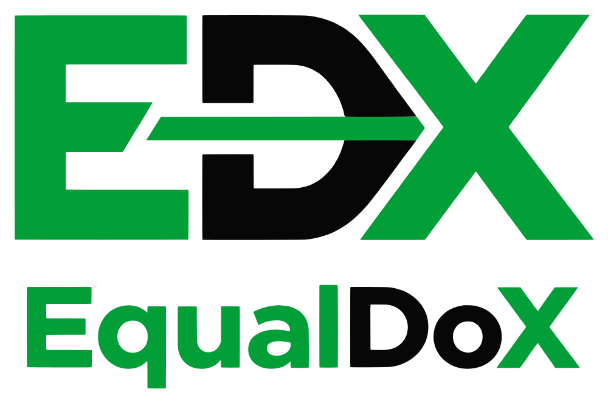
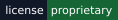
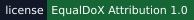
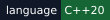

<div align="center">

<a href="https://equaldox.de">
  <picture>
    <source media="(prefers-color-scheme: dark)" srcset="assets/equaldox-logo-dark.svg">
    <source media="(prefers-color-scheme: light)" srcset="assets/equaldox-logo-light.svg">
    
  </picture>
</a>

# Making PDF Accessibility Automatic.

EqualDoX makes existing PDF documents accessible, automatically.<br>
We remediate PDFs and validate the results against the machine-checkable requirements of **PDF/UA** and **EN 301 549**, for organizations that publish documents at scale.

[](https://equaldox.de)
[](https://github.com/EqualDoX/DoX-Validate)
[](mailto:kontakt@equaldox.de)

</div>

## What we build

<table>
<tr>
<td width="50%" valign="top">

### EqualDoX Platform

[](https://equaldox.de)
[](https://equaldox.de)

Commercial platform for automated PDF accessibility remediation and validation, designed for organizations that process large numbers of PDF documents.

- **Automated remediation** of existing PDFs: tags and headings, reading order, tables, forms, alternative text, language and metadata, including scanned pages
- **Automatic validation** against the machine-checkable requirements of PDF/UA and EN 301 549
- **Review view and report** showing what was changed, what was validated and what still needs human judgement
- **Built for volume** with multi-file uploads and an API for organization accounts
- **Processed in Germany** on document processing infrastructure located in Germany

<sub>Proprietary software, offered as a service.</sub>

**→ [equaldox.de](https://equaldox.de)**

</td>
<td width="50%" valign="top">

### DoX-Validate

[](https://github.com/EqualDoX/DoX-Validate/blob/main/LICENSE)
[](https://github.com/EqualDoX/DoX-Validate)
[](https://github.com/EqualDoX/DoX-Validate#installation)

Publicly available command-line validator for automated PDF accessibility checks, developed by EqualDoX.

- **One pass, many standards:** PDF/UA-1, PDF/UA-2, WTPDF 1.0 and WCAG 2.0 / 2.1 / 2.2 at levels A, AA and AAA
- **2,008 rules** based on the machine-checkable checks of veraPDF and PAC 2026, plus EqualDoX color-contrast checks
- **Actionable findings** with rule id, standard clause, page and PDF object
- **Transparent results:** never a blanket "pass"; every report lists what a person still has to evaluate
- **Built for pipelines:** one native binary without network access, versioned JSON output, exit codes and parallel batch runs

<sub>Free for private, internal, academic and commercial use under the <a href="https://github.com/EqualDoX/DoX-Validate/blob/main/LICENSE">EqualDoX Attribution License 1.0</a>.</sub>

**→ [EqualDoX/DoX-Validate](https://github.com/EqualDoX/DoX-Validate)**

</td>
</tr>
</table>

### Get started with DoX-Validate

```sh
git clone https://github.com/EqualDoX/DoX-Validate.git && cd DoX-Validate
cmake -S . -B build -G Ninja -DCMAKE_BUILD_TYPE=Release && ninja -C build
build/dox-validate --format json --pretty report.pdf
```

Requires a C++20 compiler, CMake, Ninja and qpdf 12 or newer; see the [installation guide](https://github.com/EqualDoX/DoX-Validate#installation) for all dependencies.<br>
**Docs:** [README](https://github.com/EqualDoX/DoX-Validate#readme) · [JSON output](https://github.com/EqualDoX/DoX-Validate/blob/main/docs/JSON_OUTPUT.md) · [Standards coverage](https://github.com/EqualDoX/DoX-Validate/blob/main/docs/STANDARDS.md) · [Architecture](https://github.com/EqualDoX/DoX-Validate/blob/main/docs/ARCHITECTURE.md) · [License](https://github.com/EqualDoX/DoX-Validate/blob/main/LICENSE)

## About EqualDoX

EqualDoX focuses on one problem: making document accessibility a routine, automated step instead of a manual project.

- **Automated.** Repetitive technical remediation runs without manual work, from a single file to entire document collections.
- **Reliable.** Every result is validated, and cases that cannot be decided with sufficient confidence are flagged for review, not hidden.
- **Practical.** EqualDoX works on the documents organizations already have and preserves their content and appearance wherever possible.

| Standard | Role |
| :-- | :-- |
| **PDF/UA**&nbsp;(ISO&nbsp;14289) | The technical standard for accessible PDF documents |
| **WCAG&nbsp;2.1&nbsp;Level&nbsp;AA** | The success criteria that EN 301 549 applies to documents |
| **EN&nbsp;301&nbsp;549** | The European accessibility standard; German requirements such as BITV 2.0 and the BFSG are measured against it |

## Contact

Questions about the platform, integrations or DoX-Validate? Write to **[kontakt@equaldox.de](mailto:kontakt@equaldox.de)** or visit **[equaldox.de](https://equaldox.de)** ([English](https://equaldox.de/en/)).

<div align="center">
<sub>EqualDoX · Mannheim, Germany</sub>
</div>
